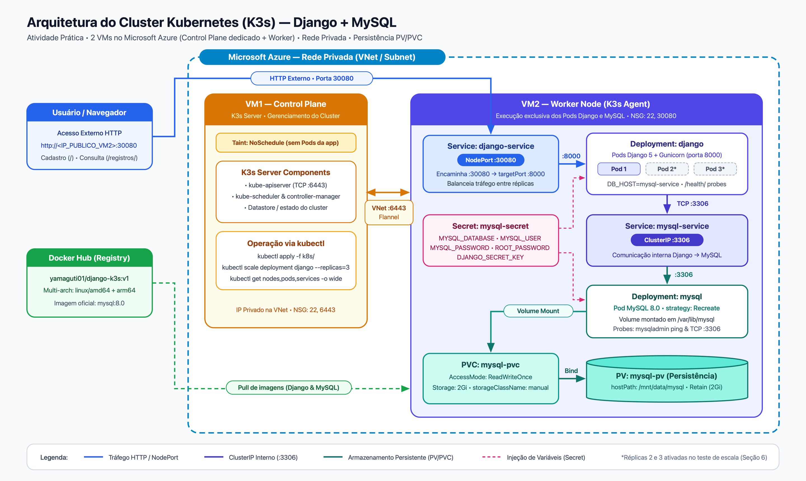

# Implantação de Aplicação Django + MySQL em Kubernetes (K3s)

Repositório da atividade prática de implantação de uma aplicação web desenvolvida em **Python/Django** com persistência em **MySQL** em um cluster Kubernetes (**K3s**) com dois nós (**VM1 Control Plane** e **VM2 Worker**) na rede privada do Microsoft Azure.

---

## Arquitetura do Cluster



> Arquivos editáveis do diagrama também disponíveis em [`docs/arquitetura.drawio`](docs/arquitetura.drawio) e [`docs/arquitetura.svg`](docs/arquitetura.svg).

---

## Estrutura do Repositório

```text
.
├── app/                              # Código-fonte da aplicação Django + Dockerfile
│   ├── config/                       # Configurações Django (conexão MySQL via env vars)
│   ├── contatos/                     # Formulário (nome, e-mail, mensagem) e página de consulta
│   ├── Dockerfile                    # Imagem Python 3.12 slim + Gunicorn
│   ├── entrypoint.sh                 # Aguarda MySQL, aplica migrations e inicia Gunicorn
│   └── requirements.txt
├── k8s/                              # Manifestos YAML do Kubernetes
│   ├── 01-mysql-secret.yaml          # Credenciais do MySQL e DJANGO_SECRET_KEY
│   ├── 02-mysql-pv.yaml              # PersistentVolume (2Gi, hostPath, Retain)
│   ├── 03-mysql-pvc.yaml             # PersistentVolumeClaim vinculado ao PV
│   ├── 04-mysql-deployment.yaml      # Deployment MySQL 8.0 (strategy: Recreate)
│   ├── 05-mysql-service.yaml         # Service ClusterIP (mysql-service:3306)
│   ├── 06-django-deployment.yaml     # Deployment "django" (DB_HOST=mysql-service)
│   └── 07-django-service.yaml        # Service NodePort (porta externa 30080)
├── docs/
│   ├── arquitetura.png               # Desenho da arquitetura em alta resolução
│   ├── arquitetura.svg               # Versão vetorial do diagrama
│   └── arquitetura.drawio            # Arquivo editável no Draw.io
└── docker-compose.yml                # Stack local para validação com MySQL 8.0
```

---

## Recursos Kubernetes Configurados

| Recurso | Nome | Tipo / Detalhes | Arquivo |
| :--- | :--- | :--- | :--- |
| **Secret** | `mysql-secret` | Credenciais do banco e `DJANGO_SECRET_KEY` | [`k8s/01-mysql-secret.yaml`](k8s/01-mysql-secret.yaml) |
| **PersistentVolume** | `mysql-pv` | `2Gi`, `ReadWriteOnce`, `Retain`, `/mnt/data/mysql` | [`k8s/02-mysql-pv.yaml`](k8s/02-mysql-pv.yaml) |
| **PersistentVolumeClaim** | `mysql-pvc` | Vinculado a `mysql-pv` (`storageClassName: manual`) | [`k8s/03-mysql-pvc.yaml`](k8s/03-mysql-pvc.yaml) |
| **Deployment (MySQL)** | `mysql` | `mysql:8.0`, `strategy: Recreate`, probes TCP/`mysqladmin` | [`k8s/04-mysql-deployment.yaml`](k8s/04-mysql-deployment.yaml) |
| **Service (MySQL)** | `mysql-service` | `ClusterIP` interno na porta `3306` | [`k8s/05-mysql-service.yaml`](k8s/05-mysql-service.yaml) |
| **Deployment (Django)** | `django` | `yamaguti01/django-k3s:v1`, `DB_HOST=mysql-service`, `/health/` | [`k8s/06-django-deployment.yaml`](k8s/06-django-deployment.yaml) |
| **Service (Django)** | `django-service` | `NodePort` na porta externa `30080` → `8000` | [`k8s/07-django-service.yaml`](k8s/07-django-service.yaml) |

---

## Imagem Docker Publicada

- **Docker Hub:** [`yamaguti01/django-k3s:v1`](https://hub.docker.com/r/yamaguti01/django-k3s)
- **Plataformas:** multi-arquitetura (`linux/amd64` e `linux/arm64`)

---

## Como Executar Localmente (Docker Compose)

```bash
docker compose up -d --build
```

- Formulário de cadastro: `http://localhost:8000/`
- Consulta de registros: `http://localhost:8000/registros/`
- Healthcheck (conexão com MySQL): `http://localhost:8000/health/`

Para encerrar e remover volumes locais:
```bash
docker compose down -v
```

---

## Comandos de Implantação e Escalabilidade (Cluster K3s)

### 1. Control Plane (VM1 — sem executar Pods da aplicação)
```bash
curl -sfL https://get.k3s.io | INSTALL_K3S_EXEC="server \
  --node-ip=<IP_PRIVADO_VM1> \
  --advertise-address=<IP_PRIVADO_VM1> \
  --tls-san=<IP_PUBLICO_VM1> \
  --node-taint node-role.kubernetes.io/control-plane=true:NoSchedule" sh -

sudo cat /var/lib/rancher/k3s/server/node-token
```

### 2. Worker (VM2 — conectado pela rede privada)
```bash
curl -sfL https://get.k3s.io | K3S_URL="https://<IP_PRIVADO_VM1>:6443" \
  K3S_TOKEN="<TOKEN_DA_VM1>" \
  INSTALL_K3S_EXEC="agent --node-ip=<IP_PRIVADO_VM2>" sh -
```

### 3. Aplicar manifestos e validar o cluster
```bash
kubectl apply -f k8s/
kubectl get nodes,pods,services -o wide
```

### 4. Escalabilidade e gerenciamento de réplicas
```bash
kubectl scale deployment django --replicas=3
kubectl get pods -o wide
kubectl delete pod <nome-do-pod>
kubectl scale deployment django --replicas=1
```
